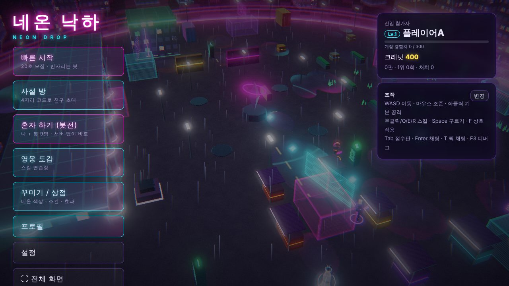
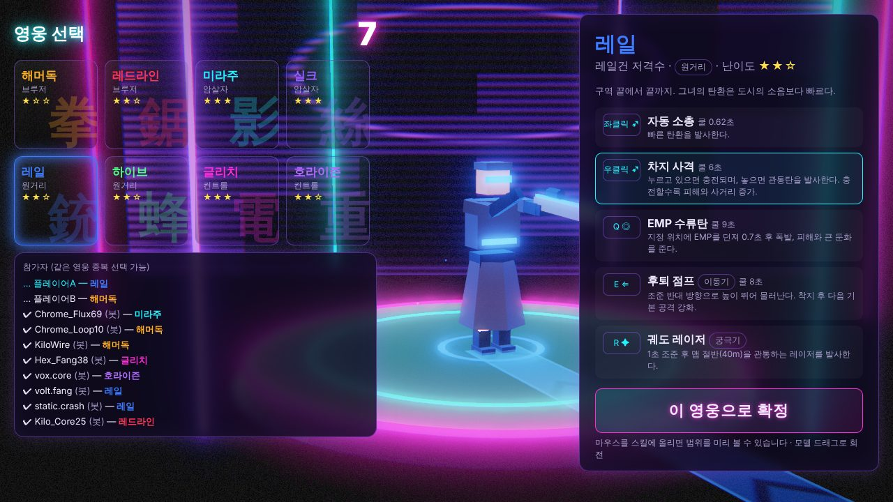
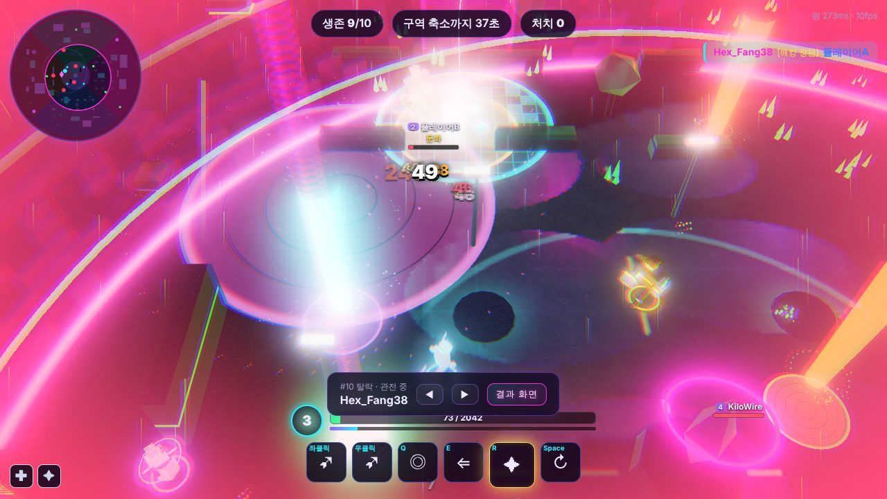
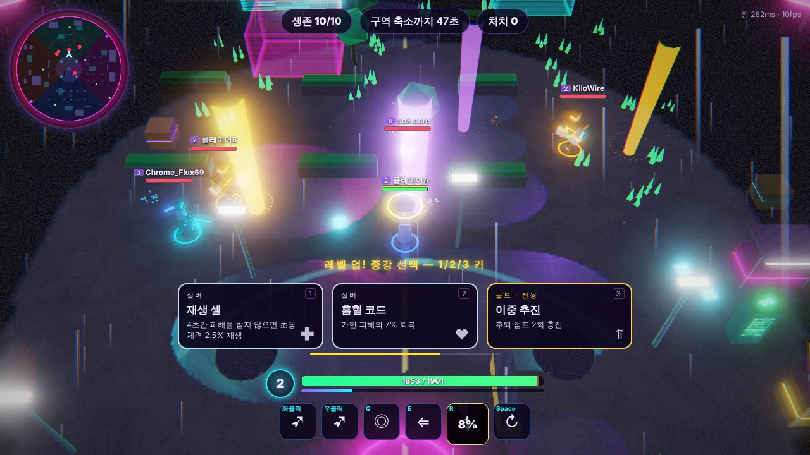
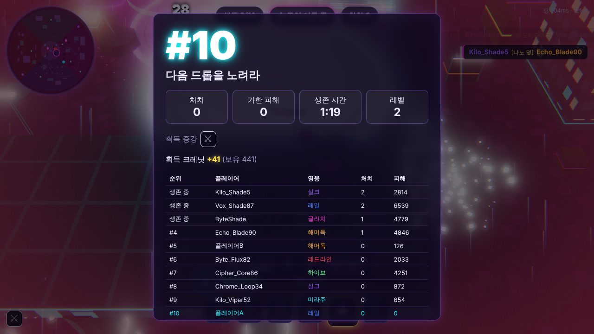

# 네온 낙하 (Neon Drop)

> 2099년 네온 메가시티 「신서울」의 버려진 구역. 기업이 생중계하는 불법 데스게임 **「드롭」**에서 최후의 1인을 가린다.

쿼터뷰 3D 핵앤슬래시 **배틀로얄** 웹 멀티플레이 게임입니다. 한 판 최대 10명 개인전, 빈자리는 봇이 채우고, 짧고 강렬한 한 판(봇 10명 기준 평균 약 4분 30초, 구역 일정상 최대 약 6분 30초)을 목표로 만들었습니다. 브라우저만 있으면 친구와 바로 플레이할 수 있습니다.

| 로비 | 영웅 선택 |
|---|---|
|  |  |
| **전투** | **증강 선택** |
|  |  |



*(스크린샷은 `npm run e2e`가 헤드리스 브라우저(소프트웨어 렌더링)로 찍은 장면입니다. E2E는 판을 빨리 끝내려고 구역을 6배 가속하므로, 전투 장면의 플레이어가 붕괴 구역 밖에 있을 수 있습니다.)*

---

## 1. 빠른 실행

요구 사항: **Node.js 20 이상** (22 권장)

```bash
npm install && npm run dev
```

- 브라우저에서 `http://localhost:5173` 접속
- 콘솔에 표시되는 **LAN 주소**(`http://192.168.x.x:5173`)로 같은 네트워크의 친구가 바로 접속할 수 있습니다.
- 개발 모드는 게임 서버(8787)와 Vite(5173)를 함께 띄우고, Vite가 `/ws`를 게임 서버로 프록시합니다.

### 프로덕션 실행 (서버 하나로 정적 파일 + WebSocket)

```bash
npm run build && npm start
```

`http://localhost:8787` 하나의 Node 프로세스가 클라이언트 정적 파일, WebSocket(`/ws`), 상태 확인(`/health`)을 모두 서빙합니다.

### 서버 없이 플레이 (혼자 하기 · 오프라인 체험판)

로비의 **혼자 하기 (봇전)** 은 서버 없이 브라우저 안에서 나 + 봇 9명 배틀로얄을 진행합니다(봇 난이도 선택 가능, 크레딧·전적은 저장되지 않음). 서버 연결 없이 정적 파일만으로 동작하는 체험판은 다음으로 만듭니다:

```bash
npm run build:offline
```

`client/dist-offline/`을 아무 정적 호스팅에 올리면 봇전과 스킬 연습장을 바로 플레이할 수 있습니다. 친구와의 멀티플레이는 아래 배포 절의 서버가 필요합니다.

### 네트워크 상황 테스트

URL에 `?lag=120&loss=5`처럼 붙이면 인위적인 지연(왕복 ms, 편도에 절반씩)과 게임 패킷 손실(%)을 넣습니다. 예: `http://localhost:5173/?lag=150&loss=5`

### 기타 명령

| 명령 | 설명 |
|---|---|
| `npm test` | Vitest 단위 테스트 (피해/증강 계산, 시야 판정, 지연 보상, 바이너리 직렬화 왕복, 구역 축소, 시전 규칙) |
| `npm run typecheck` | shared / server / client 타입 검사 |
| `npm run balance` | 헤드리스 밸런스 시뮬레이션 (어려움 봇 10명 × 2000판). `--games N`, `--level 0~2`, `--seed S`, `--write`(README 표 갱신) |
| `npm run deploy:server` / `deploy:hosting` | Firebase 배포 (Cloud Run 서버 / Hosting + Firestore 규칙). 아래 배포 절 참고 |
| `npm run docs` | 데이터 파일에서 README의 영웅/스킬/증강 표 재생성 |
| `npm run e2e:queue` | 대기열·관전 테스트 (동시 판 1개로 제한한 서버에서 만석 → 관전 대기 → 자리 나면 자동 시작) |
| `npm run e2e` | Playwright 종단 간 테스트 (`npm run build` 후 실행, `playwright` 패키지와 Chromium 필요) |

---

## 2. 조작법

| 입력 | 동작 |
|---|---|
| **WASD** | 이동 |
| **마우스** | 조준 |
| **좌클릭** | 기본 공격 (누르고 있으면 연속) |
| **우클릭** | 스킬 1 |
| **Q** | 스킬 2 |
| **E** | 스킬 3 (모든 영웅의 이동기) |
| **R** | 궁극기 (피해를 주거나 받으면 충전) |
| **Space** | 공용 회피 구르기 (짧은 무적, 4초 쿨타임) |
| **F** | 상호작용 (회복 자판기, 기업 보급품) |
| **Tab** (누르고 있기) | 점수판 — 다른 플레이어의 레벨과 획득 증강까지 확인 (정보 전쟁) |
| **Enter** | 전체 채팅 |
| **T** (누르고 있기) | 퀵 채팅 / 감정 표현 휠 |
| **1 / 2 / 3** | 증강 카드 선택 (마우스 클릭도 가능) |
| **마우스 휠** | 약간의 줌 |
| **F3** (변경 가능) | 디버그 오버레이 (FPS, 핑, 서버 틱, 보정 횟수, 패킷 크기, 히트박스 표시) |

### 키보드만으로 (마우스 없이)

마우스를 쓰지 않으면 자동으로 **가장 가까운 적을 조준**합니다(설정 → 조준 방식: 자동/마우스/키보드 자동 조준). 적이 없으면 이동 방향을 봅니다.

| 키 | 동작 |
|---|---|
| **J** | 기본 공격 (누르고 있으면 연속) |
| **K** | 스킬 1 (우클릭과 같은 기능) |
| Q / E / R / Space / F | 스킬 2 / 이동기 / 궁극기 / 구르기 / 상호작용 (공통) |
| 낙하 단계: WASD → J 또는 Space | 낙하 지점 표시를 옮긴 뒤 낙하 |
| 관전 중 ← / → | 관전 대상 변경 |
| 메뉴: Tab / Enter | 버튼·영웅 카드 이동과 선택, 증강은 1/2/3 (변경 가능) |

J·K도 설정에서 다른 키로 바꿀 수 있습니다.

**키보드 스킬 자동 조준** (설정 → 키보드 스킬 조준, 기본 켜짐): 마우스를 쓰는 중이라도 *키보드 키로* 쓴 공격·스킬(Q/E/R, J/K 등)은 사거리 안의 **가장 가까운 적**(영웅 우선, 중립 몬스터는 후순위)에게 자동으로 조준합니다. 이동기(스킬 3)는 이동 중이면 이동 방향으로 나가고, 사거리 안에 적이 없으면 원래 조준(마우스 위치)을 씁니다. 마우스 버튼에 지정된 동작은 계속 마우스로 조준합니다.

### 렉 완화

- **자동 해상도**: 프레임이 약 42fps 아래로 떨어지면 렌더 해상도를 단계적으로 낮추고(최저 55%), 여유가 생기면 천천히 되돌립니다. F3 디버그에 현재 해상도가 표시됩니다.
- **보간 지연 자동 조절**: 네트워크가 흔들리면(지터) 보간 지연을 133ms에서 최대 약 300ms까지 부드럽게 늘리고, 스냅샷이 늦게 오면 다른 영웅을 직전 속도로 최대 4틱 이어서 움직여 끊김을 줄입니다.
- **서버 따라잡기 최적화**: 무료 서버의 CPU가 밀려 여러 틱을 한꺼번에 처리할 때는 마지막 틱에만 스냅샷을 보냅니다(건너뛴 틱의 이벤트는 함께 전달).
- **스냅샷 15Hz**: 시뮬레이션은 30Hz 그대로, 스냅샷은 2틱마다 보내 서버 부담과 대역폭을 절반으로 줄였습니다(`SNAPSHOT_EVERY`로 조절).
- **입력 속도 제한은 실제 시간 기준**: 서버가 느려져도 정상 입력이 버려지지 않고, 제한에 걸린 입력의 버튼 누름(스킬·낙하)은 보존됩니다.

### 휴대폰·태블릿 (터치)

터치 기기에서는 자동으로 터치 조작이 켜집니다(설정 → 터치 조작: 자동/켜기/끄기).

| 터치 | 동작 |
|---|---|
| 화면 왼쪽 아무 곳 누르고 끌기 | 이동 조이스틱 |
| 오른쪽 아래 큰 버튼 | 기본 공격 (누르고 있으면 연속, 가까운 적 자동 조준, 끌면 직접 조준) |
| 스킬·궁극기 버튼 **탭** | 가장 가까운 적에게 자동 조준해 시전 |
| 스킬·궁극기 버튼 **끌기 → 떼기** | 끈 방향으로 조준 후 시전 (범위 표시, 지점형 스킬은 끈 길이로 거리 조절). 위쪽 ✕ 위에서 떼면 취소 |
| ↻ / F 버튼 | 구르기 / 상호작용 (근처에 자판기·보급품이 있을 때 나타남) |
| 빈 곳 탭 | 그 방향으로 기본 공격 (낙하 단계에서는 낙하 지점 선택) |
| 왼쪽 위 ☰ ≡ ✉ ☺ | 메뉴 / 점수판 / 채팅 / 퀵 채팅·감정 표현 |

가로 화면을 권장합니다(세로에서는 카메라를 조금 멀리 잡고 안내가 뜹니다). 타이틀·로비의 **⛶ 전체 화면** 버튼은 지원 브라우저에서 전체 화면 + 가로 고정을 시도합니다. 노치·홈 바 영역은 비워 두고 배치합니다.

### 공통

- **네온 빛 강도** (설정): 건물·간판·홀로그램의 네온과 빛 번짐 세기를 조절합니다(기본은 이전보다 약하게). 영웅의 네온 파츠는 알아보기 쉽도록 덜 줄어듭니다.
- **스마트 시전** (설정): 켜면 키를 누르는 즉시 시전(키를 누르고 있는 동안 범위 표시), 끄면 키를 눌러 범위를 확인한 뒤 좌클릭으로 시전합니다. 레일의 차지 사격처럼 충전형 스킬은 항상 누르고 있다가 떼면 발사됩니다.
- **키 설정**: 로비의 *설정* 또는 게임 중 **Esc → 키 설정**에서 모든 동작(이동·기본 공격·스킬 1~3·궁극기·구르기·상호작용·점수판·채팅·퀵 채팅·증강 선택 1~3·관전 이전/다음·디버그)을 키보드 키나 마우스 버튼(좌/우/휠/4/5)으로 바꿀 수 있습니다. 이미 쓰이는 키를 고르면 두 동작의 키가 서로 바뀌고, 항목별 *기본값* 버튼과 *전체 초기화*가 있습니다. 고정 키는 Esc(메뉴/취소) 하나뿐입니다. 설정은 브라우저에 저장되며, 바꾼 키는 HUD 스킬바와 영웅 선택 화면에 바로 반영됩니다.

---

## 3. 한 판의 흐름

1. **매칭** — *빠른 시작*: 20초 동안 사람을 모으고 부족한 자리는 보통 난이도 봇으로 채워 10명 시작(남은 시간과 인원 표시).
   - **동시 진행 판 수 제한**: 서버는 동시에 `MAX_MATCHES`판(기본 2)까지만 돌립니다. 가득 차면 대기열 순번이 표시되고, 기다리는 동안 **진행 중인 판을 관전**합니다(◀ ▶로 관전 대상 변경, 관전자는 실제 참가자 한 명의 시야만 봄). 판이 끝나 자리가 나면 대기 순서대로 자동으로 영웅 선택에 들어갑니다. 무료 서버(CPU 0.1개)에서 사람 10명이 꽉 찬 한 판은 CPU 한도의 약 45%를 씁니다.
   - *사설 방*: 현재 **준비 중**입니다. 서버 환경 변수 `PRIVATE_ROOM_MIN_LEVEL`을 지정하면 그 계정 레벨 이상부터 열립니다(4자리 코드 초대, 방장이 봇 채우기·난이도 설정 후 시작, 동시 진행 판 수 제한 적용).
   - *혼자 하기(봇전)*와 *연습장*은 브라우저 안에서 돌아 서버 자리를 쓰지 않습니다.
2. **영웅 선택 (15초)** — 같은 영웅 중복 선택 가능. 3D 모델 회전(드래그), 역할, 난이도, 스킬 설명, 스킬에 마우스를 올리면 범위 미리보기 애니메이션. 장착한 색상/스킨이 반영됩니다.
3. **낙하** — 수송 드론이 맵을 가로지르는 동안 원하는 지점을 클릭하면 2초 착지 연출과 함께 내려갑니다(10초 안에 고르지 않으면 무작위).
4. **성장** — 적 처치, 중립 *보안 드론* 처치, 맵의 *데이터 코어* 획득으로 경험치 → 레벨 1~8. **레벨업마다 증강 3장 중 1장 선택** (게임은 계속 진행, 10초 후 자동 선택). 레벨이 오를수록 골드/프리즘 확률 증가.
5. **데이터 붕괴** — 60초마다 안전 구역이 줄어들고 다음 구역은 20초 전에 표시됩니다. 밖에 있으면 지속 피해(단계마다 증가). 마지막 1분은 안전 구역이 계속 움직입니다.
6. **기업 보급품** — 판 중 2회 낙하 예고(미니맵 표시, 사이렌) → 1.5초 상호작용(피격 시 취소)으로 열면 **프리즘 증강 1장 즉시 선택** + 보호막.
7. **회복** — 1회용 회복 자판기(체력 40%), 처치 시 15% 회복, 4초간 전투하지 않으면 자연 회복.
8. **사망** — 나를 처치한 플레이어 시점으로 관전 전환, ◀ ▶로 관전 대상 변경, *결과 화면* 버튼.
9. **결과** — 순위, 처치, 가한 피해, 생존 시간, 획득 증강, 획득 크레딧. **한 판 더!** 를 누르면 같은 사람들끼리 다시 영웅 선택으로 넘어갑니다.

**맵** — 지름 약 80m의 신서울 버려진 구역. *중앙 광장 · 네온 시장 · 고가 철도 아래 · 폐공장 · 옥상 정원* 5개 구역, 시드 기반 배치 변형. 엄폐물(벽·컨테이너·차량 잔해)과 피해를 받으면 부서지는 엄폐물, 들어가면 밖에서 안 보이는 **홀로그램 광고판 구역**(풀숲), 점프 패드 4개, 텔레포트 게이트 한 쌍.

**시야** — 쿼터뷰 시야 + 벽 뒤 시야 차단(전장의 안개). 시야 판정은 서버가 하고, 보이지 않는 적의 정보는 아예 전송하지 않습니다.

---

## 4. 영웅과 스킬

8명, 역할 4종 × 2명. 모든 영웅은 기본 공격 + 스킬 3개(E는 이동기) + 충전형 궁극기를 가집니다. 모든 수치는 `shared/src/data/heroes.ts`에 데이터로 정의되어 있어 **코드 수정 없이 밸런싱**할 수 있습니다.

<!-- HEROES:START -->
#### 해머독 — 유압 주먹 전직 경비원 (브루저, 난이도 ★☆☆)
체력 1950 · 이동 속도 5.4m/s · 궁극기 충전 1125 피해

| 키 | 스킬 | 쿨타임 | 설명 |
|---|---|---:|---|
| 좌클릭 | 유압 잽 | 0.7초 | 전방을 강하게 후려친다. |
| 우클릭 | 충격 펀치 | 6초 | 충격파를 날려 맞은 적을 밀쳐낸다. |
| Q | 지면 강타 | 8초 | 주변 지면을 내려쳐 피해를 주고 둔화시킨다. |
| E | 유압 돌진 (이동기) | 9초 | 전방으로 돌진해 처음 맞은 적을 붙잡아 내리꽂고 기절시킨다. |
| R | 낙하 해머 (궁극기) | 충전형 | 반경 7m 안의 적을 모두 끌어당긴 뒤 내려찍어 큰 피해를 주고 기절시킨다. |

전용 증강: **강화 유압**(골드) 유압 돌진 거리 +3m, 기절 시간 +0.5초 · **여진**(골드) 지면 강타가 0.6초 후 한 번 더 발동한다 · **중력 해머**(프리즘) 낙하 해머 범위 +40%, 시전 시 220 보호막

#### 레드라인 — 체인소 칼날 폭주족 (브루저, 난이도 ★★☆)
체력 2080 · 이동 속도 5.65m/s · 궁극기 충전 1200 피해

| 키 | 스킬 | 쿨타임 | 설명 |
|---|---|---:|---|
| 좌클릭 | 체인소 베기 | 0.55초 | 넓은 범위를 톱날로 벤다. |
| 우클릭 | 회전 베기 | 9초 | 2.5초간 회전하며 주변 적에게 지속 피해를 준다. |
| Q | 체인 블레이드 | 7초 | 톱날을 던져 관통하는 모든 적에게 피해를 주고 둔화시킨다. |
| E | 번아웃 (이동기) | 8초 | 엔진을 폭발시켜 전방으로 질주하며 경로의 적에게 피해를 준다. |
| R | 풀 스로틀 (궁극기) | 충전형 | 18m를 무적 상태로 질주하며 경로 전체의 적을 베고 옆으로 튕겨낸다. |

전용 증강: **흡혈 톱날**(골드) 회전 베기 피해의 45%만큼 회복 · **부메랑 체인**(골드) 체인 블레이드가 끝에 도달하면 되돌아온다 · **니트로**(프리즘) 번아웃 2회 충전, 피해 +30

#### 미라주 — 광학 위장 닌자 (암살자, 난이도 ★★★)
체력 1380 · 이동 속도 6m/s · 궁극기 충전 1050 피해

| 키 | 스킬 | 쿨타임 | 설명 |
|---|---|---:|---|
| 좌클릭 | 쌍검 베기 | 0.45초 | 빠르게 두 번 벤다. |
| 우클릭 | 수리검 | 5초 | 빠른 수리검을 던져 피해를 주고 4초간 표식을 남긴다. 표식 대상은 궁극기 우선 대상. |
| Q | 광학 위장 | 14초 | 3.5초간 은신하고 이동 속도가 증가한다. 은신 중 첫 공격은 피해 60% 증가. |
| E | 섬광 베기 (이동기) | 7초 | 조준 방향으로 순간이동하며 경로의 적을 벤다. |
| R | 천 개의 잔상 (궁극기) | 충전형 | 조준 지점 근처의 적(표식 대상 우선)에게 무적 상태로 연속 점멸 공격 5회. |

전용 증강: **그림자 수확**(프리즘) 은신 중 또는 은신 해제 후 1.5초 안에 처치하면 모든 스킬 쿨타임 초기화 · **삼중 수리검**(골드) 수리검을 부채꼴로 3개 던진다 · **무한 잔상**(프리즘) 천 개의 잔상 타격 횟수 +3

#### 실크 — 나노와이어 거미 (암살자, 난이도 ★★★)
체력 1760 · 이동 속도 5.9m/s · 궁극기 충전 1125 피해

| 키 | 스킬 | 쿨타임 | 설명 |
|---|---|---:|---|
| 좌클릭 | 와이어 휘두르기 | 0.6초 | 긴 사거리로 와이어를 휘두른다. |
| 우클릭 | 나노 덫 | 5초 | 지정 위치에 보이지 않는 덫을 설치한다. 밟은 적은 속박되고 피해를 입는다. (최대 3개) |
| Q | 와이어 채찍 | 7초 | 와이어를 날려 맞은 적을 끌어당기고 둔화시킨다. |
| E | 와이어 스윙 (이동기) | 7초 | 와이어를 쏴서 벽에 맞으면 벽까지 빠르게 당겨 붙는다 (최대 12m). 벽에 붙으면 다음 기본 공격 강화. |
| R | 거미줄 영역 (궁극기) | 충전형 | 넓은 구역에 와이어 그물을 친다. 안의 적은 1초 속박되고, 4초간 크게 둔화되며 지속 피해를 입는다. |

전용 증강: **덫 공장**(골드) 나노 덫 최대 5개, 쿨타임 -2초 · **강철 와이어**(골드) 와이어 스윙 후 130 보호막 · **포식**(프리즘) 거미줄 영역이 끝날 때 적을 중심으로 끌어당기며 130 피해

#### 레일 — 레일건 저격수 (원거리, 난이도 ★★☆)
체력 1760 · 이동 속도 5.5m/s · 궁극기 충전 1200 피해

| 키 | 스킬 | 쿨타임 | 설명 |
|---|---|---:|---|
| 좌클릭 | 자동 소총 | 0.62초 | 빠른 탄환을 발사한다. |
| 우클릭 | 차지 사격 | 6초 | 누르고 있으면 충전되며, 놓으면 관통탄을 발사한다. 충전할수록 피해와 사거리 증가. |
| Q | EMP 수류탄 | 9초 | 지정 위치에 EMP를 던져 0.7초 후 폭발, 피해와 큰 둔화를 준다. |
| E | 후퇴 점프 (이동기) | 8초 | 조준 반대 방향으로 높이 뛰어 물러난다. 착지 후 다음 기본 공격 강화. |
| R | 궤도 레이저 (궁극기) | 충전형 | 1초 조준 후 맵 절반(40m)을 관통하는 레이저를 발사한다. |

전용 증강: **반사 회로**(프리즘) 끝까지 충전한 차지 사격이 벽에 2회 반사된다 · **이중 추진**(골드) 후퇴 점프 2회 충전 · **연속 조사**(프리즘) 궤도 레이저를 0.7초 간격으로 2번 발사한다

#### 하이브 — 드론 조종사 (원거리, 난이도 ★★☆)
체력 1720 · 이동 속도 5.6m/s · 궁극기 충전 1200 피해

| 키 | 스킬 | 쿨타임 | 설명 |
|---|---|---:|---|
| 좌클릭 | 펄스 권총 | 0.48초 | 연사형 에너지탄. |
| 우클릭 | 마이크로 미사일 | 6초 | 부채꼴로 미사일 3발을 발사해 착탄 지점에서 폭발한다. |
| Q | 전투 드론 | 10초 | 지정 위치에 9초간 적을 자동 사격하는 드론을 배치한다. (최대 2대) |
| E | 부스터 팩 (이동기) | 8초 | 조준 방향으로 날아오르며 잠시 이동 속도가 증가한다. |
| R | 편대 폭격 (궁극기) | 충전형 | 지정 구역에 드론 편대가 연속 폭탄을 투하한다. |

전용 증강: **드론 군단**(골드) 전투 드론 최대 3대, 사격 속도 +33% · **미사일 포드**(골드) 마이크로 미사일 5발 발사 · **융단 폭격**(프리즘) 편대 폭격 폭탄 +5, 범위 +1m

#### 글리치 — 해커 (컨트롤, 난이도 ★★★)
체력 1720 · 이동 속도 5.75m/s · 궁극기 충전 1125 피해

| 키 | 스킬 | 쿨타임 | 설명 |
|---|---|---:|---|
| 좌클릭 | 데이터 볼트 | 0.55초 | 데이터 탄을 발사한다. |
| 우클릭 | 봉인 코드 | 7.5초 | 맞은 적의 스킬을 1.6초간 봉인하고 피해를 준다. |
| Q | 해킹 장판 | 11초 | 지정 위치에 5초간 해킹 장판을 깔고, 해킹된 포탑이 장판 안의 적을 사격한다. |
| E | 패킷 전송 (이동기) | 8초 | 지정 위치로 순간이동한다. |
| R | 시스템 오버라이드 (궁극기) | 충전형 | 반경 8m 안 모든 적의 조작을 3초간 반전시키고 피해를 준다. |

전용 증강: **연쇄 감염**(골드) 봉인 코드가 근처 적 1명에게 튕긴다 · **이중 해킹**(골드) 해킹 장판 포탑의 사격 속도 +80% · **커널 패닉**(프리즘) 시스템 오버라이드 범위 +3m, 반전 시간 +1.5초

#### 호라이즌 — 중력 연구원 (컨트롤, 난이도 ★★☆)
체력 1760 · 이동 속도 5.5m/s · 궁극기 충전 1200 피해

| 키 | 스킬 | 쿨타임 | 설명 |
|---|---|---:|---|
| 좌클릭 | 중력 구체 | 0.7초 | 느린 중력 구체로 맞은 적을 살짝 둔화시킨다. |
| 우클릭 | 중력장 | 8초 | 지정 위치에 3초간 중력장을 만들어 적을 둔화시키고 지속 피해를 준다. |
| Q | 척력파 | 9초 | 전방 부채꼴의 적을 강하게 밀쳐낸다. |
| E | 중력 도약 (이동기) | 9초 | 지정 위치로 도약해 착지 지점의 적에게 피해와 둔화를 준다. |
| R | 특이점 (궁극기) | 충전형 | 지정 위치에 3초간 블랙홀을 생성해 적을 중심으로 끌어당기며 피해를 준다. |

전용 증강: **사건의 지평선**(프리즘) 특이점이 끝날 때 폭발해 반경 4.5m에 190 피해 · **관성 서핑**(골드) 중력장 안에서 자신의 이동 속도 +35% · **충돌 계산**(골드) 척력파로 벽에 부딪힌 적은 1.2초 기절

#### 공용 증강

| 등급 | 증강 | 효과 |
|---|---|---|
| 실버 | ⚔ 강화 서보 | 공격력 +10% |
| 실버 | ⛨ 나노 장갑 | 최대 체력 +12% |
| 실버 | ⟳ 오버클럭 | 스킬 쿨타임 -10% |
| 실버 | ➶ 경량 프레임 | 이동 속도 +7% |
| 실버 | ⚡ 신경 가속 | 기본 공격 속도 +15% |
| 실버 | ↯ 회피 회로 | 구르기 쿨타임 -30% |
| 실버 | ◈ 데이터 흡수 | 경험치 획득 +40%, 이동 속도 +3% |
| 실버 | ✚ 재생 셀 | 4초간 피해를 받지 않으면 초당 체력 2.5% 재생 |
| 실버 | ✦ 궁극 증폭기 | 궁극기 충전 속도 +30% |
| 실버 | ♥ 흡혈 코드 | 가한 피해의 7% 회복 |
| 실버 | ⌖ 정밀 조준 | 투사체 속도와 사거리 +12% |
| 실버 | ▣ 반응 장갑 | 받는 피해 -8% |
| 골드 | ✪ 처치 회로 | 적 처치 시 최대 체력의 30% 회복 |
| 골드 | ◎ 비상 보호막 | 체력 30% 이하가 되면 최대 체력 28% 보호막 (20초 쿨) |
| 골드 | ϟ 삼연 번개 | 기본 공격 3타마다 주변 적 2명에게 번개 65 피해 |
| 골드 | ⇶ 돌진 충전 | 이동기(E) 사용 후 다음 기본 공격 피해 +90% |
| 골드 | ♨ 화상 탄두 | 스킬 적중 시 3초간 초당 16 화상 피해 |
| 골드 | ❄ 냉각 코팅 | 스킬 적중 시 1초간 25% 둔화 |
| 골드 | ☠ 처형자 | 체력 30% 이하의 적에게 주는 피해 +22% |
| 골드 | ➹ 사냥 본능 | 처치 시 4초간 이동 속도 +35% |
| 골드 | ≋ 잔상 질주 | 구르기 후 1.2초간 이동 속도 +40% |
| 골드 | ∞ 스킬 연계 | 스킬 적중 시 다른 스킬 쿨타임 0.6초 감소 |
| 골드 | ✸ 전투 자극제 | 피해를 받을 때마다 3초간 공격력 +5% (최대 5중첩) |
| 골드 | ➤ 전투 개시자 | 5초간 피해를 주지 않았다면 다음 공격 피해 +65% |
| 골드 | ✷ 가시 장갑 | 받은 피해의 18%를 공격자에게 반사 |
| 골드 | ◐ 충격 구르기 | 구르기 거리 +35%, 구르기 경로의 적에게 50 피해 |
| 프리즘 | ☄ 오버드라이브 | 공격력 +18%, 스킬 쿨타임 -15% |
| 프리즘 | ☥ 불사 프로토콜 | 치명상을 입으면 1회 2초간 무적이 되고 체력 30%로 버틴다 |
| 프리즘 | ✹ 연쇄 폭발 | 적 처치 시 시체가 폭발해 반경 4.5m에 160 피해 |
| 프리즘 | ⧉ 양자 이중화 | 스킬 사용 시 25% 확률로 쿨타임을 소모하지 않는다 |
| 프리즘 | ✺ 궁극 회로 | 궁극기 사용 시 모든 스킬 쿨타임 초기화, 궁극기 충전 +20% |
| 프리즘 | ⬢ 거인화 | 최대 체력 +26%, 받는 피해 -5%, 크기 +15%, 이동 속도 -5% |
| 프리즘 | ♛ 흡혈 군주 | 흡혈 +14%, 초과 회복은 보호막으로 전환 |
| 프리즘 | ⛈ 데이터 폭풍 | 2.5초마다 주변 6m 안의 적 1명에게 자동 번개 55 피해 |
<!-- HEROES:END -->

증강 규칙: 같은 증강 중복 불가, 영웅 전용 증강은 해당 영웅에게만 등장, 레벨별 등급 확률은 `TIER_ODDS`(`shared/src/data/augments.ts`). 시너지 예: *삼연 번개 + 신경 가속*, *돌진 충전 + 오버클럭 + 회피 회로*, *처치 회로 + 사냥 본능 + 연쇄 폭발*, *흡혈 코드 + 흡혈 군주*, *화상 탄두 + 스킬 연계 + 냉각 코팅*.

---

## 5. 밸런스 결과

`npm run balance`는 렌더링 없이 서버와 같은 공유 시뮬레이션만 돌리는 **헤드리스 모드**로, 어려움 난이도 봇 10명(영웅 무작위 선택)으로 2000판을 자동 진행합니다(워커 스레드 병렬, 4코어에서 약 1분). 기준: **모든 영웅의 1위 비율이 기대값(무작위 선택 기준 10%) 대비 ±25% 이내.** 증강의 *1위 기여도*는 같은 영웅·같은 증강 개수(≈레벨) 플레이어들의 1위 비율로 기대 1위 수를 구해 실제 1위 수와 비교한 값입니다(1.0 = 평균, 영웅 강도와 레벨 효과를 걸러냄).

조정 과정: 첫 측정에서 근접 암살자/브루저(미라주 +229%, 해머독 +139%)가 압도적이고 원거리·컨트롤(하이브 −89%, 레일 −83%)이 크게 약했습니다. 체력·피해·궁극기 수치를 데이터 파일에서 4차례 조정해 모두 기준 안으로 들였고, 극단값 증강(거인화, 데이터 흡수)도 다듬었습니다. 판 길이도 처음엔 약 1분으로 지나치게 짧아, 체력 상향·비전투 회복·봇의 시간대별 교전 성향·중후반 안전 구역 크기를 조정해 봇만으로 평균 약 4분 30초(사람이 섞이면 더 길어지고, 구역 일정상 최대 약 6분 30초)가 되도록 맞췄습니다.

<!-- BALANCE:START -->

**2000판, 어려움 봇 10명, 시드 20990** · 평균 판 길이 4.53분 · 기대 1위 비율 10.0% (허용 7.5%~12.5%)

| 영웅 | 출전 | 1위 비율 | 기대 대비 | 평균 순위 | 평균 처치 | 평균 피해 | 판정 |
|---|---:|---:|---:|---:|---:|---:|:---:|
| 해머독 | 2422 | 9.6% | -3.8% | 4.92 | 0.95 | 3744 | ✅ |
| 레드라인 | 2501 | 10.1% | +1.2% | 5.30 | 0.92 | 4524 | ✅ |
| 미라주 | 2515 | 11.4% | +13.7% | 5.42 | 1.17 | 3180 | ✅ |
| 실크 | 2499 | 11.0% | +10.4% | 5.60 | 1.07 | 4291 | ✅ |
| 레일 | 2451 | 9.5% | -4.5% | 4.67 | 0.71 | 6178 | ✅ |
| 하이브 | 2543 | 8.7% | -13.1% | 6.21 | 0.73 | 4113 | ✅ |
| 글리치 | 2589 | 8.7% | -13.5% | 6.15 | 0.75 | 3991 | ✅ |
| 호라이즌 | 2480 | 11.0% | +10.1% | 5.67 | 0.89 | 4369 | ✅ |

<details><summary>증강별 1위 기여도 (전체 58종, 1.0 = 평균)</summary>

| 증강 | 등급 | 전용 | 획득 수 | 보유 시 1위 비율 | 1위 기여도 (실제÷기대) | 평균 순위 |
|---|---|---|---:|---:|---:|---:|
| 중력 해머 | 프리즘 | 해머독 | 331 | 42.3% | 1.16 | 2.71 |
| 거인화 | 프리즘 | - | 1051 | 47.4% | 1.11 | 2.45 |
| 여진 | 골드 | 해머독 | 534 | 24.7% | 1.07 | 3.48 |
| 무한 잔상 | 프리즘 | 미라주 | 239 | 45.2% | 1.06 | 2.58 |
| 이중 해킹 | 골드 | 글리치 | 658 | 19.9% | 1.06 | 4.62 |
| 흡혈 군주 | 프리즘 | - | 1048 | 42.1% | 1.05 | 2.78 |
| 삼중 수리검 | 골드 | 미라주 | 996 | 24.0% | 1.05 | 3.82 |
| 연쇄 감염 | 골드 | 글리치 | 675 | 19.4% | 1.05 | 4.72 |
| 재생 셀 | 실버 | - | 591 | 16.4% | 1.05 | 4.09 |
| 니트로 | 프리즘 | 레드라인 | 396 | 38.9% | 1.04 | 2.94 |
| 미사일 포드 | 골드 | 하이브 | 631 | 21.9% | 1.04 | 4.49 |
| 이중 추진 | 골드 | 레일 | 1158 | 15.3% | 1.04 | 3.82 |
| 오버드라이브 | 프리즘 | - | 1019 | 42.7% | 1.04 | 2.89 |
| 전투 자극제 | 골드 | - | 1239 | 23.8% | 1.03 | 3.94 |
| 포식 | 프리즘 | 실크 | 406 | 40.6% | 1.03 | 2.87 |
| 데이터 폭풍 | 프리즘 | - | 1019 | 42.5% | 1.03 | 2.98 |
| 강화 유압 | 골드 | 해머독 | 585 | 24.3% | 1.03 | 3.46 |
| 관성 서핑 | 골드 | 호라이즌 | 649 | 22.8% | 1.03 | 4.07 |
| 강철 와이어 | 골드 | 실크 | 675 | 26.7% | 1.03 | 3.49 |
| 궁극 회로 | 프리즘 | - | 971 | 44.6% | 1.02 | 2.76 |
| 흡혈 톱날 | 골드 | 레드라인 | 639 | 22.7% | 1.02 | 3.76 |
| 삼연 번개 | 골드 | - | 1240 | 23.5% | 1.02 | 3.84 |
| 처치 회로 | 골드 | - | 1276 | 20.5% | 1.01 | 4.17 |
| 스킬 연계 | 골드 | - | 1225 | 24.7% | 1.01 | 3.91 |
| 부메랑 체인 | 골드 | 레드라인 | 627 | 23.8% | 1.01 | 3.77 |
| 나노 장갑 | 실버 | - | 1399 | 15.9% | 1.01 | 4.19 |
| 돌진 충전 | 골드 | - | 1280 | 23.1% | 1.00 | 3.78 |
| 드론 군단 | 골드 | 하이브 | 654 | 20.8% | 1.00 | 4.54 |
| 커널 패닉 | 프리즘 | 글리치 | 382 | 34.8% | 1.00 | 3.45 |
| 가시 장갑 | 골드 | - | 1277 | 22.5% | 1.00 | 4.15 |
| 반응 장갑 | 실버 | - | 1382 | 14.5% | 0.99 | 4.32 |
| 불사 프로토콜 | 프리즘 | - | 931 | 37.8% | 0.99 | 2.69 |
| 신경 가속 | 실버 | - | 590 | 13.2% | 0.99 | 4.71 |
| 융단 폭격 | 프리즘 | 하이브 | 354 | 33.3% | 0.99 | 3.56 |
| 전투 개시자 | 골드 | - | 1190 | 21.8% | 0.99 | 4.00 |
| 화상 탄두 | 골드 | - | 1261 | 21.4% | 0.99 | 4.04 |
| 비상 보호막 | 골드 | - | 1296 | 21.5% | 0.99 | 3.76 |
| 양자 이중화 | 프리즘 | - | 1000 | 36.6% | 0.99 | 3.05 |
| 충돌 계산 | 골드 | 호라이즌 | 670 | 21.5% | 0.98 | 4.23 |
| 연속 조사 | 프리즘 | 레일 | 240 | 31.3% | 0.98 | 2.67 |
| 덫 공장 | 골드 | 실크 | 684 | 23.2% | 0.97 | 4.10 |
| 흡혈 코드 | 실버 | - | 1342 | 13.1% | 0.97 | 4.46 |
| 냉각 코팅 | 골드 | - | 1273 | 19.6% | 0.97 | 4.07 |
| 사건의 지평선 | 프리즘 | 호라이즌 | 387 | 34.4% | 0.96 | 3.22 |
| 강화 서보 | 실버 | - | 1384 | 12.2% | 0.95 | 5.02 |
| 연쇄 폭발 | 프리즘 | - | 966 | 32.4% | 0.95 | 3.13 |
| 처형자 | 골드 | - | 1223 | 21.3% | 0.95 | 3.99 |
| 잔상 질주 | 골드 | - | 1181 | 20.8% | 0.95 | 3.87 |
| 충격 구르기 | 골드 | - | 1267 | 19.5% | 0.95 | 4.02 |
| 그림자 수확 | 프리즘 | 미라주 | 241 | 39.8% | 0.95 | 2.76 |
| 회피 회로 | 실버 | - | 592 | 12.3% | 0.92 | 4.52 |
| 궁극 증폭기 | 실버 | - | 600 | 12.7% | 0.92 | 4.77 |
| 반사 회로 | 프리즘 | 레일 | 235 | 25.5% | 0.92 | 3.11 |
| 사냥 본능 | 골드 | - | 1279 | 18.4% | 0.92 | 4.20 |
| 정밀 조준 | 실버 | - | 1476 | 10.6% | 0.91 | 4.94 |
| 경량 프레임 | 실버 | - | 626 | 10.4% | 0.88 | 4.77 |
| 오버클럭 | 실버 | - | 557 | 11.8% | 0.83 | 4.86 |
| 데이터 흡수 | 실버 | - | 633 | 14.5% | 0.73 | 4.61 |

</details>

<!-- BALANCE:END -->

---

## 6. 구조

```
neon_drop/
├─ shared/            공용 타입, 게임 데이터, 시뮬레이션 (서버·클라이언트·헤드리스가 같은 코드 사용)
│  ├─ src/data/       heroes.ts(영웅/스킬 수치) · augments.ts(증강) · cosmetics.ts(꾸미기/크레딧/금칙어)
│  ├─ src/sim/        map(맵 생성·충돌·레이캐스트) · movement(예측 공유 이동) · skills(스킬 인터프리터)
│  │                  combat(피해/효과/처치/경험치) · augmentLogic · zone(구역 일정) · vision(시야) · lagcomp · match
│  ├─ src/bot/        brain.ts — 사람과 같은 입력만 생성하는 봇
│  ├─ src/net/        codec(바이너리) · protocol(스냅샷/입력 인코딩) · host(델타·시야 컬링·입력 검증) · messages(JSON 타입)
│  └─ test/           Vitest
├─ server/            Node + ws + better-sqlite3 — 로비/대기열/사설 방/영웅 선택/매치 루프/계정/상점
├─ client/            Vite + TypeScript + Three.js — 렌더링, HUD, 메뉴, 사운드
├─ scripts/           dev.mjs · balance.ts(+워커) · e2e.mjs · docs.ts
├─ Dockerfile · fly.toml
```

### 공유 시뮬레이션
- 30Hz 고정 틱. `Match.step()` 한 번이 서버 틱 하나입니다. 이동/충돌(`stepMove`)은 서버와 클라이언트 예측이 **같은 함수**를 사용합니다.
- 스킬은 데이터의 *액션 목록*(projectile, melee, dash, blink, aoe, zone, beam, deploy, buff, pullAll, strikes, bombard, areaAll)과 *효과*(기절, 둔화, 속박, 봉인, 조작 반전, 넉백, 끌어당김, 표식, 지속 피해)를 해석해 실행합니다. 영웅 전용 증강은 스킬 정의에 경로 기반 패치(`actions.0.count += 2` 등)를 적용해 스킬 자체를 변형합니다.
- 같은 코드를 **브라우저 안에서도** 돌려 영웅 도감 연습장과 타이틀 배경 데모(봇끼리 싸우는 판)를 만듭니다. 이때도 실제 네트워크와 똑같이 스냅샷을 직렬화/역직렬화합니다.

### 네트워크 프로토콜 (서버 권위)
- 클라이언트 → 서버: 입력만 (이동 방향 int8×2, 조준 좌표, 누르고 있는 버튼/누른 버튼 비트, 보고 있던 렌더 시점). 패킷 손실 대비 최근 입력 3개를 함께 보냅니다.
- 서버 → 클라이언트: 매 틱 **바이너리 스냅샷**. 엔티티는 양자화된 16개 필드이며, 클라이언트가 확인(ack)한 스냅샷을 기준으로 **바뀐 필드만 비트마스크로** 보냅니다(델타 압축). 기준이 없으면 전체 전송. 자기 영웅의 정밀 이동 상태·쿨타임·경험치 블록과 그 틱의 이벤트(피해 숫자, 이펙트)가 함께 갑니다.
- 저빈도 메시지(로비, 킬피드, 아나운서, 증강 제안, 점수판, 채팅)는 JSON 텍스트 프레임입니다.
- **내 캐릭터**: 클라이언트 예측 → 서버 상태 도착 시 미확인 입력을 다시 적용(재조정) → 차이는 지수 감쇠로 부드럽게 보정(4m 이상만 즉시 이동).
- **다른 플레이어**: 100ms(+지터 적응) 버퍼 보간. 투사체는 현재 시점으로 외삽해 표시합니다.
- **지연 보상**: 서버는 영웅 위치 이력을 보관하고, 발사자의 화면 시점(최대 150ms 과거)으로 되감아 근접 판정과 투사체 판정을 합니다. 투사체는 발사 시 지연만큼 따라잡기 이동을 한 뒤에도 그 시점 기준으로 계속 판정하므로 "내 화면에서 맞았으면 맞은 것"이 됩니다.
- **검증**: 모든 입력의 범위/NaN 검사, 초당 입력 수 제한(초과분 폐기), 밀린 입력 큐 정리, 쿨타임·상태이상·사거리는 전부 서버가 판정(클라이언트는 위치를 보내지 않으므로 이동 조작 불가), JSON/바이너리 크기 제한, 초당 메시지 수 제한.
- **재접속**: 끊긴 뒤 20초 안에 같은 브라우저(토큰)로 다시 접속하면 같은 판으로 복귀합니다. 그동안 캐릭터는 제자리에서 무방비이고, 20초가 지나면 탈락 처리됩니다.

### 시야 판정
서버가 매 틱 영웅 간 시야 행렬을 계산합니다: 시야 반경 15.5m, 시야 차단 장애물 레이캐스트(격자 공간 분할), 홀로그램 광고판 구역(같은 구역 안이나 2.6m 이내만 보임), 은신(1.9m 이내 또는 노출 상태만 보임). 스냅샷은 관찰자(사망 시 관전 대상) 기준으로 보이는 엔티티만 담습니다. 클라이언트는 같은 레이캐스트로 시야 다각형을 그려 바닥과 건물을 어둡게 하는 안개를 표현합니다.

### 봇
- `BotBrain`은 매치 안에서 사람과 똑같은 `InputCmd`만 만들고, 적은 서버와 같은 시야 함수로만 인식합니다(치트 없음).
- 행동: 낙하 지점 선택, 탐색/배회, 데이터 코어와 보안 드론 파밍, 교전 판단(체력·보호막·레벨·주변 적 수 비교 + 시간에 따라 커지는 공격성), 스킬 우선순위(궁극기 → 스킬 → 기본 공격, 스킬 종류별 조건), 위협 회피(날아오는 투사체·바닥 경고·적 장판을 피해 수직 이동, 임박 시 구르기), 안전 구역 이동, 도주(이동기·은신 활용), 자판기·보급품 이용, 증강 선택.
- 난이도 3단계는 반응 속도(틱), 조준 오차, 이동 예측(리드), 회피 확률, 판단 정확도로 조절합니다. 이름은 사이버펑크풍 핸들로 자동 생성.

### 렌더링과 연출
- 고정 쿼터뷰 카메라(약 49°), 부드러운 추적 + 조준 방향 선행, 휠 줌, 화면 흔들림. 낙하 단계에는 맵 전체를 내려다봅니다.
- 모든 3D 모델과 텍스처는 코드로 생성: 영웅은 관절 계층(골반-몸통-머리-팔-팔뚝-손-다리-정강이) 로우폴리 모델 + 툰 셰이딩/림라이트 + 영웅별 실루엣(유압 주먹, 체인소, 쌍검과 스카프, 거미 다리 6개, 레일건과 코트, 백팩과 미니 드론, 후드와 홀로 스크린, 연구 가운과 중력 링), 스킨별 파츠 변형, 팔레트별 네온 색. 이동/공격/스킬 종류별/구르기/공중/기절/피격/감정 표현 애니메이션은 모두 코드.
- 사이버펑크 아트: 절차적 창문과 네온 띠의 건물, 홀로그램 간판(스캔라인 셰이더), 젖은 바닥(높음: 평면 반사 렌더, 중간/낮음: 페인트된 네온 반사), 빗방울과 바닥 파문, 블룸(듀얼 필터), 약한 색수차, 비네팅, 필름 그레인.
- 타격감: 히트스톱(클라이언트 연출), 피격 플래시, 넉백, 화면 흔들림, 데미지 숫자, 처치 시 복셀로 흩어지는 디지털 분해(처치 효과별 변형), 데이터 붕괴 경계 글리치 셰이더.
- 품질 설정(낮음/중간/높음): 해상도 배율, MSAA, 블룸 단계, 파티클·비·복셀 수, 반사 on/off. 인스턴싱(소품/가로등/복셀/비), 파티클 풀링, 단일 드로우콜 파티클.

### 사운드 (WebAudio 절차 합성, 파일 없음)
영웅별 스킬음(유압 타격, 체인소, 칼바람, 와이어, 레이저 충전, 미사일/사이렌, 디지털 비프, 중력 저음), 타격/피격/처치/레벨업/증강(등급별)/보급 사이렌/구역 경고/낙하·착지. 거리 감쇠와 좌우 패닝으로 화면 밖 교전 방향을 들을 수 있습니다. 배경음악은 신스웨이브 시퀀서로 실시간 생성되며 남은 인원이 줄수록 템포와 레이어가 늘고, **최후 3인부터 단조 테마로 전환**됩니다.

### 계정 레벨 (실력 영향 없음)
판이 끝날 때마다 참가·순위·처치·생존 시간으로 계정 경험치를 얻습니다(`shared/src/data/account.ts`에서 조정). 레벨은 로비·프로필·결과 화면에 표시되고, 사설 방 개방 조건(`PRIVATE_ROOM_MIN_LEVEL`)에 쓰입니다.

### 꾸미기 (실력 영향 없음)
판 결과(순위·처치·생존 시간)로 크레딧 획득 → 상점에서 영웅별 네온 팔레트(영웅당 4종 + 기본), 스킨 변형(영웅당 2종), 처치 효과 4종, 낙하 효과 4종, 감정 표현, 닉네임 칭호. 구매·장착·크레딧 계산은 모두 서버에서 검증하고 SQLite에 저장합니다. 계정은 닉네임만 입력하는 게스트 계정이며 서버 토큰을 localStorage에 보관합니다(접근 실패 시에도 동작).

---

## 7. 무료로만 배포하기 (권장)

결제 카드 없이 쓰는 무료 서비스만으로 친구들과 플레이할 수 있게 구성합니다. Firebase 무료(Spark) 요금제에서는 Cloud Run을 쓸 수 없기 때문에 게임 서버는 Render 무료 플랜에 둡니다.

| 역할 | 무료 서비스 | 하는 일 |
|---|---|---|
| 게임 화면 | **GitHub Pages** | `main`에 푸시하면 `.github/workflows/pages.yml`이 자동 배포 |
| 게임 서버 | **Render 무료 웹 서비스** | `render.yaml`(Blueprint)로 `main` 푸시마다 자동 재배포, WebSocket 지원 |
| 계정·크레딧·전적 | **Firestore** (Firebase **Spark 무료** 요금제) | 서버가 서비스 계정 키로 저장 |

### 단계
1. **Firebase 프로젝트 (무료 Spark)** — [Firebase 콘솔](https://console.firebase.google.com)에서 프로젝트를 만들고 *Firestore Database → 데이터베이스 만들기*(위치 `asia-northeast3` 서울, 프로덕션 모드). *규칙* 탭에 이 저장소의 `firestore.rules` 내용을 붙여 넣고 게시합니다(브라우저의 직접 접근 차단).
2. **서비스 계정 키** — Firebase 콘솔 → 프로젝트 설정 → 서비스 계정 → *새 비공개 키 생성* → JSON 파일을 내려받습니다. (이 파일은 저장소에 올리지 마세요.)
3. **저장소를 `main`에 합치기** — 자동 배포는 `main` 브랜치 기준입니다.
4. **Render** — [render.com](https://render.com) 가입(GitHub 계정으로) → *New → Blueprint* → 이 저장소 선택. 입력 칸 두 개를 채웁니다.
   - `FIREBASE_SERVICE_ACCOUNT`: 2단계 JSON 파일 내용 전체를 붙여 넣기
   - `ALLOWED_ORIGINS`: `https://<깃허브아이디>.github.io`
   배포가 끝나면 서버 주소(`https://neon-drop-xxxx.onrender.com`)가 나옵니다. `…/health`를 열어 `"store":"firestore"`가 보이면 정상입니다.
5. **GitHub Pages** — 저장소 Settings → Pages → Source를 **GitHub Actions**로. Settings → Secrets and variables → Actions → *Variables*에 `SERVER_URL` = 4단계 서버 주소. Actions 탭에서 *GitHub Pages 배포*를 한 번 실행(이후는 `main` 푸시마다 자동).
6. 접속: `https://<깃허브아이디>.github.io/neon_drop/` — 이 주소를 친구에게 보내면 됩니다.

### 무료 플랜의 제약
- **서버 잠들기**: Render 무료 서버는 15분 동안 아무 접속이 없으면 잠들고, 다음 접속 때 깨어나는 데 최대 1분쯤 걸립니다. 화면에 "서버를 깨우는 중…"이 표시되고, 그동안에도 혼자 하기(봇전)·연습장은 바로 할 수 있습니다. 판이 진행되는 동안에는 게임 메시지가 계속 오가므로 잠들지 않습니다.
- **성능**: 무료 서버는 CPU 0.1개입니다. 실측으로 사람 10명이 꽉 찬 한 판이 한도의 약 45%, 세 판이면 약 84%를 써서, `render.yaml`은 동시 판을 2개(`MAX_MATCHES=2`)로 제한합니다. 넘치는 사람은 관전하며 자리를 기다립니다.
- **Firestore 무료 사용량**: 하루 읽기·쓰기 횟수에 한도가 있습니다. 이 게임은 접속할 때 1회 읽고, 판이 끝나거나 상점을 쓸 때만 쓰므로 소규모로는 넉넉합니다. 한도를 넘으면 그날은 저장이 실패하고(게임은 계속됨) 다음 날 복구됩니다.
- **키를 넣지 않으면**: 서버는 경고를 남기고 임시 SQLite로 동작합니다. 이 경우 서버가 재시작·재배포될 때마다 계정과 크레딧이 초기화됩니다.
- 비용이 생길 수 있는 설정(Firebase Blaze, Cloud Run)은 아래 8절이며, 이 구성에서는 필요 없습니다. `deploy-firebase.yml` 워크플로는 `GCP_PROJECT_ID` 변수가 없으면 실행되지 않으니 그대로 두면 됩니다.

## 8. 배포 — Firebase + Cloud Run (유료 Blaze 요금제 필요)

> Cloud Run은 Firebase 무료(Spark) 요금제에서 쓸 수 없고, 결제 계정을 연결한 Blaze 요금제가 필요합니다. 소규모 사용량은 대부분 무료 사용량 안에 들어가지만 카드 등록이 필요하므로, 무료로만 운영하려면 위 7절을 쓰세요.

### Firebase + Cloud Run 구성

Firebase Hosting은 정적 파일만 서빙하고 Cloud Functions는 WebSocket을 지원하지 않기 때문에, 같은 Firebase(Google Cloud) 프로젝트 안에서 다음처럼 나눠 올립니다.

| 역할 | 서비스 | 내용 |
|---|---|---|
| 게임 클라이언트 | **Firebase Hosting** | `client/dist` 정적 파일 (`https://<프로젝트>.web.app`) |
| 게임 서버 | **Cloud Run** (서울 `asia-northeast3`) | 저장소의 `Dockerfile` 그대로, WebSocket 지원 |
| 계정·크레딧·전적 | **Cloud Firestore** | `STORE=firestore` 로 서버가 Admin SDK로 저장. 브라우저 직접 접근은 `firestore.rules`로 전부 차단 |

클라이언트는 빌드할 때 넣은 Cloud Run 주소(`VITE_SERVER_URL`)로 직접 WebSocket(`wss://…/ws`)에 접속하고, 서버는 `ALLOWED_ORIGINS`에 적힌 Hosting 도메인에서 온 접속만 받습니다.

### 준비물
- Firebase 프로젝트 (**Blaze 요금제** — Cloud Run 사용에 결제 계정 연결이 필요합니다. 소규모는 대부분 무료 사용량 안에 들어갑니다)
- [Firebase CLI](https://firebase.google.com/docs/cli)와 [Google Cloud CLI](https://cloud.google.com/sdk/docs/install)

### 단계
1. **로그인**
   ```bash
   firebase login
   ```
   ```bash
   gcloud auth login
   ```
2. **프로젝트 연결** — `.firebaserc`의 `your-firebase-project-id`를 실제 프로젝트 ID로 바꾸거나:
   ```bash
   firebase use --add
   ```
3. **필요한 API 켜기와 Firestore 생성** (최초 1회, `내프로젝트`를 실제 ID로)
   ```bash
   gcloud services enable run.googleapis.com cloudbuild.googleapis.com artifactregistry.googleapis.com firestore.googleapis.com --project 내프로젝트
   ```
   ```bash
   gcloud firestore databases create --location=asia-northeast3 --project 내프로젝트
   ```
4. **게임 서버를 Cloud Run에 배포** — 끝나면 서버 주소(`https://neon-drop-…-du.a.run.app`)가 출력됩니다.
   ```bash
   PROJECT_ID=내프로젝트 npm run deploy:server
   ```
   `scripts/deploy-cloudrun.sh`가 하는 일: 소스(`Dockerfile`)로 빌드 → `STORE=firestore`, `ALLOWED_ORIGINS=https://내프로젝트.web.app,https://내프로젝트.firebaseapp.com` 설정 → **인스턴스 1개 고정**(`--max-instances 1`, 매치·로비가 서버 메모리에 있음), 요청 제한 시간 60분(긴 WebSocket 연결), 세션 어피니티, CPU 상시 할당(접속 사이에도 게임 루프가 돌도록). 기본 Compute 서비스 계정으로 Firestore에 접근하므로 별도 키 파일은 필요 없습니다. 조직 정책으로 권한이 막혀 있다면 그 서비스 계정에 `Cloud Datastore 사용자(roles/datastore.user)` 역할을 주세요.
5. **클라이언트에 서버 주소 넣기** — `client/.env.production.example`을 `client/.env.production`으로 복사하고 4단계의 주소를 넣습니다.
   ```
   VITE_SERVER_URL=https://neon-drop-…-du.a.run.app
   ```
6. **Hosting과 Firestore 규칙 배포** (`firebase.json`의 predeploy가 클라이언트를 빌드하며, 서버 주소가 없으면 빌드를 멈추고 알려줍니다)
   ```bash
   npm run deploy:hosting
   ```
7. 접속: `https://내프로젝트.web.app` — 이 주소를 친구에게 보내면 됩니다. 서버 상태는 `https://neon-drop-…-du.a.run.app/health` (`"store":"firestore"`가 보이면 정상).

참고:
- **사용자 지정 도메인**을 Hosting에 붙였다면 그 주소도 허용해야 합니다: `ALLOWED_ORIGINS="https://내도메인,https://내프로젝트.web.app" PROJECT_ID=내프로젝트 npm run deploy:server`
- 업데이트: 서버를 바꿨으면 4단계, 클라이언트를 바꿨으면 6단계만 다시 실행합니다. 둘 사이의 프로토콜이 바뀌면 둘 다 배포하세요(구버전 클라이언트에는 새로고침 안내가 뜹니다).
- 아무도 접속하지 않으면 Cloud Run 인스턴스가 0개로 내려가 비용이 들지 않고, 다음 접속 때 몇 초 안에 다시 켜집니다. 항상 켜 두려면 스크립트의 `--min-instances 0`을 `1`로 바꾸세요(상시 과금).
- Cloud Run의 WebSocket 연결은 최대 60분 뒤 끊기지만 클라이언트가 자동으로 다시 접속하고, 판 도중이면 20초 재접속 규칙으로 같은 판에 복귀합니다.
- 로컬에서 Firestore 저장소 확인: `npx firebase-tools emulators:start --only firestore --project demo-neon` 실행 후 `FIRESTORE_EMULATOR_HOST=127.0.0.1:8085 STORE=firestore FIRESTORE_PROJECT_ID=demo-neon npm start`. 같은 환경 변수로 `npm test`를 돌리면 Firestore 저장소 테스트도 실행됩니다.

### 깃허브로 자동 배포 (GitHub Actions)

위 단계를 한 번 손으로 하지 않아도, 저장소 설정만 해 두면 **`main`에 푸시할 때마다** 테스트 → Cloud Run 서버 → Firebase Hosting + Firestore 규칙이 자동으로 배포됩니다 (`.github/workflows/deploy-firebase.yml`). 게임 서버 자체는 GitHub에서 돌릴 수 없으므로 실행 위치는 여전히 Firebase/Cloud Run이고, GitHub은 배포를 대신 해 줍니다.

1. 위 Firebase 절의 1~3단계(프로젝트 생성, Blaze 요금제, API 사용 설정, Firestore 생성)는 처음 한 번 필요합니다.
2. **배포용 서비스 계정 만들기** (Google Cloud 콘솔 → IAM → 서비스 계정): 다음 역할을 줍니다.
   `Cloud Run 관리자`, `Cloud Build 편집자`, `Artifact Registry 관리자`, `서비스 계정 사용자`, `스토리지 관리자`, `Firebase 호스팅 관리자`, `Firebase 규칙 관리자`, `서비스 사용량 소비자`
   그 계정의 **키(JSON)** 를 하나 만들어 내려받습니다.
3. **깃허브 저장소 설정** (Settings → Secrets and variables → Actions)
   - Variables: `GCP_PROJECT_ID` = Firebase 프로젝트 ID
   - Secrets: `GCP_SA_KEY` = 2번의 JSON 내용 전체
4. `main`에 푸시하거나 Actions 탭에서 **Firebase 배포 → Run workflow**. 실행 요약에 게임 주소와 서버 상태 주소가 나옵니다.

`GCP_PROJECT_ID`가 없으면 이 워크플로는 건너뜁니다. 키 파일 대신 Workload Identity Federation을 쓰려면 `google-github-actions/auth` 단계의 `credentials_json`을 `workload_identity_provider` / `service_account`로 바꾸면 됩니다.

### GitHub Pages로 올리기 (`.github/workflows/pages.yml`)

저장소 Settings → Pages → Source를 **GitHub Actions**로 바꾸면 `main` 푸시마다 `https://<아이디>.github.io/<저장소>/`에 클라이언트가 올라갑니다.
- 기본: 서버 없이 되는 **체험판**(혼자 하기 봇전 + 연습장)
- 변수 `SERVER_URL`에 Cloud Run 서버 주소를 넣으면 **멀티플레이 정식 버전**. 이때 서버가 그 페이지를 허용하도록 변수 `EXTRA_ORIGINS`에 `https://<아이디>.github.io`를 넣고 Firebase 배포를 다시 실행하세요.

`.github/workflows/ci.yml`은 PR과 `main` 푸시마다 타입 검사·테스트·빌드·축소 밸런스 시뮬레이션을 돌립니다.

## 9. 배포 — Fly.io (서버 하나로 전부, 유료)


WebSocket과 영구 볼륨(SQLite)을 지원하고 소규모는 무료~저렴하게 운영할 수 있는 **Fly.io**를 기준으로 안내합니다. 저장소에 `Dockerfile`과 `fly.toml`이 포함되어 있습니다.

1. **flyctl 설치 및 로그인**
   ```bash
   curl -L https://fly.io/install.sh | sh
   ```
   ```bash
   fly auth login
   ```
2. **앱 생성** (저장소 루트에서, 기존 `fly.toml` 사용. 앱 이름은 전역에서 고유해야 하므로 원하는 이름으로)
   ```bash
   fly launch --no-deploy --copy-config --name my-neon-drop
   ```
3. **SQLite 데이터용 영구 볼륨 생성** (`fly.toml`의 `[[mounts]]`와 이름이 같아야 함, 리전은 `primary_region`과 동일)
   ```bash
   fly volumes create neon_data --region nrt --size 1
   ```
4. **배포**
   ```bash
   fly deploy
   ```
5. 접속: `https://my-neon-drop.fly.dev` — 친구에게 이 주소를 공유하면 서로 다른 인터넷 환경에서도 함께 플레이할 수 있습니다. 상태 확인은 `https://my-neon-drop.fly.dev/health`.

참고:
- **HTTPS/WSS 자동 전환**: 클라이언트는 페이지가 `https:`이면 `wss://`, 아니면 `ws://`로 같은 호스트의 `/ws`에 접속합니다. Fly는 `force_https = true`로 TLS를 자동 처리합니다.
- **볼륨은 머신 1대에 붙습니다.** 게임 상태(매치)는 서버 메모리에 있으므로 머신을 1대로 유지하세요(`fly scale count 1`). 한 서버에서 여러 매치를 동시에 돌리며(매치별 독립 루프, 빈 매치 자동 정리), 매치 하나의 틱 비용은 약 0.4ms 수준입니다.
- `auto_stop_machines = "stop"`이면 접속자가 없을 때 머신이 멈추고 접속 시 자동으로 깨어납니다(첫 접속이 몇 초 느릴 수 있음). 항상 켜 두려면 `min_machines_running = 1`.
- 로그: `fly logs`

### 다른 호스팅 / 직접 실행
- **Docker**:
  ```bash
  docker build -t neon-drop .
  ```
  ```bash
  docker run -p 8080:8080 -v neon-data:/data neon-drop
  ```
- **일반 Node 서버**: `npm ci && npm run build && npm start` (리버스 프록시 사용 시 `/ws`의 WebSocket 업그레이드 헤더를 통과시켜야 합니다).

### 환경 변수

| 변수 | 기본값 | 설명 |
|---|---|---|
| `PORT` | `8787` (Docker는 `8080`) | HTTP/WebSocket 포트 |
| `HOST` | `0.0.0.0` | 바인드 주소 |
| `DATA_DIR` | `./data` (Docker는 `/data`) | SQLite 파일 위치 — 영구 볼륨을 여기에 마운트 |
| `DB_PATH` | `$DATA_DIR/neon-drop.db` | DB 파일 경로 직접 지정 |
| `STATIC_DIR` | `client/dist` | 정적 파일 위치 |
| `MAX_MATCHES` | `2` | 동시에 진행할 수 있는 판 수. 넘치는 사람은 대기열에서 관전하며 기다림 |
| `PRIVATE_ROOM_MIN_LEVEL` | (없음 = 준비 중) | 사설 방을 열 수 있는 계정 레벨 |
| `STORE` | `sqlite` | 계정 저장소: `sqlite` 또는 `firestore` |
| `FIREBASE_SERVICE_ACCOUNT` | (없음) | 외부 호스팅(Render 등)에서 Firestore에 접속할 서비스 계정 JSON (그대로 또는 base64) |
| `FIRESTORE_PROJECT_ID` | (자동) | Firestore 프로젝트 ID (`STORE=firestore`일 때) |
| `FIRESTORE_PREFIX` | (없음) | 컬렉션 이름 접두어 (테스트와 운영 데이터를 나눌 때) |
| `ALLOWED_ORIGINS` | (모두 허용) | WebSocket 접속을 허용할 페이지 출처, 쉼표 구분 (예: Firebase Hosting 주소) |
| `VITE_SERVER_URL` | (같은 호스트) | **클라이언트 빌드용**: 서버가 다른 도메인일 때 서버 주소 (`client/.env.production`) |
| `NEON_XP_MULT` | `1` | 테스트용 경험치 배율 (E2E 전용, 운영에서는 설정하지 마세요) |
| `SNAPSHOT_EVERY` | `2` | 스냅샷 간격(틱). 1 = 30Hz, 2 = 15Hz, 3 = 10Hz |
| `NEON_TIME_SCALE` | `1` | 테스트용 구역/보급 진행 가속 (E2E 전용) |

---

## 10. 검증

- `npm test` — 34개 단위 테스트 통과 (피해 공식과 보호막, 레벨 배율, 구르기 무적, 처치 보상, 증강 합산·상한·패치·중복 금지, 바이너리 왕복과 실제 호스트 스냅샷 델타 연쇄, 지연 보상(되감기 시 명중/없으면 빗나감), 시야(거리·벽·홀로그램 구역·은신), 구역 축소 일정, 쿨타임/봉인 검증, 봇 매치 완주).
- `npm run balance` — 위 밸런스 표.
- `npm run e2e` — 브라우저 컨텍스트 2개가 서로 다른 게스트로 같은 사설 방에 입장 → 봇 채워서 시작 → 영웅 선택 → 낙하 → 서로를 향해 이동·공격·스킬·구르기 → 두 화면의 위치/구역/생존 인원 동기화 확인 → 데이터 코어로 레벨업 → 증강 선택(키보드와 클릭) → 결과 화면, 그리고 `?lag=150&loss=5`로 한 번 더 실행합니다. 콘솔 에러 0개가 통과 조건이며 위 스크린샷을 저장합니다.
